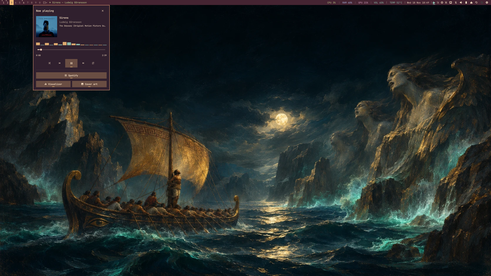
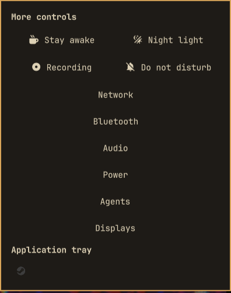
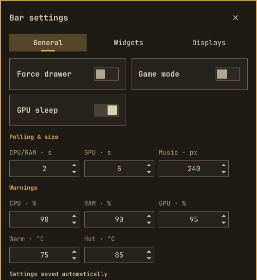

# Omarchy DWM Bar



One Omarchy shell plugin for the complete dwm-style top bar. Workspaces, layout switching, music, text metrics, temperature, state controls and a flat system tray are bundled together. No companion plugins, installer script, layout copying or separate tray installation.

## Install

```bash
omarchy plugin install https://github.com/Anky209e/omarchy-dwm-bar.git --enable
```

`install` is Omarchy's alias for `plugin add`. `--enable` selects the bar immediately after installation. The plugin ID is **`anky.dwm-bar`**. Omarchy handles cloning, validation and enabling; its normal review/confirmation prompt still applies.

To update an installed copy:

```bash
omarchy plugin update anky.dwm-bar
```

To switch between bars without removing this plugin:

```bash
omarchy bar use omarchy.bar
omarchy bar use anky.dwm-bar
```

The original `bar.layout`, idle settings and unrelated plugins remain in `shell.json`. Enabling this plugin selects `bar.id`; the plugin supplies its own layout at runtime. To remove it, first select `omarchy.bar`, then run `omarchy plugin remove anky.dwm-bar`.

## Layout

```text
LEFT   workspaces → layout symbol → music
RIGHT  CPU | RAM | GPU | VOL | TEMP | date/time | idle/night/recording/DND | connections | tray | settings
```

- Numbered workspace tags with a solid active-tag highlight and occupied markers.
- `[]=` tiled, `|||` scrolling and `><>` floating layout symbols.
- Fixed-width, elided music title; theme color indicates playback, without an underline.
- Tight CPU, RAM, GPU and volume text blocks, plus an independent temperature block.
- Fixed-order corner controls. Nothing expands on hover.
- Native Omarchy calendar, network, Bluetooth, audio, power and keyboard controls.
- Registered add-on widgets from your saved Omarchy bar layout, including Agents and optional monitor configuration, appear in the corner group. Settings → Widgets → Plugins controls this group.
- The flat tray implementation is included under its MIT license; a separate Flat Tray plugin is unnecessary. Its icons appear when applications register tray items. Keyboard layout follows Omarchy's normal visibility rules.

The bar always sits at the top. It respects the current background setting: `omarchy bar background opaque`, `glassy`, or `none`. The core layout is defined in `DwmBar.qml`. Additional registered widgets enabled in `bar.layout` are collected into the corner group, with duplicates removed and their settings preserved. For example, `omarchy bar put omarchy.agents --section right` adds Agents; optional plugins must already be installed. Moving an add-on between saved sections does not relocate the fixed DWM core.

## Controls

| Item | Action |
| --- | --- |
| Workspace tag | Left click selects; right click opens Omarchy's menu; wheel navigates |
| Layout symbol | Click cycles the current workspace layout |
| Music | Left click opens the music panel; right click play/pause; middle click next |
| CPU / RAM | Left click opens `btop`; right click refreshes hardware once |
| GPU / temperature | Left click opens `nvtop`; right click refreshes hardware once |
| Volume text | Left click opens audio; right click mutes; wheel adjusts by 5%, capped at 100% |
| Date/time | Open Omarchy's calendar |
| Coffee icon | Toggle stay-awake / normal idle locking |
| Night light | Toggle screen temperature |
| Recording | Open recording choices, or stop an active recording |
| DND | Toggle notification silencing |
| Native connection, audio and power icons | Open their normal panels |
| Tray | Application actions and context menus |
| Gear | Open persistent bar settings |

There is no window-title widget, DEV shortcut or focus timer.

## Settings and monitor layouts

Click the gear at the right edge, or run `omarchy-shell dwm.bar.ui settings`. The theme-native panel is organized into General, Widgets and Displays tabs. General groups Game mode and GPU sleep toggles, polling/size controls and warning thresholds. Hover a toggle for its description. Visualizer and Cover art controls live only in the music panel. Game mode is manual-only; there are no game-class rules or automatic detection.

Preferences are validated and saved atomically in `~/.config/omarchy/dwm-bar.json` (under `XDG_CONFIG_HOME` when set). The prior file is retained as `dwm-bar.json.bak`. Invalid values fall back to safe defaults; a failed save is shown in the panel. No manual configuration is required.

Each connected display can use:

- **Full:** all enabled widgets.
- **Minimal:** workspace tags, music and the settings button.
- **Hidden:** no bar widgets and no reserved screen space.

The default is Full on every display. Display choices persist by output name. If all bars are hidden, reopen the panel with `omarchy-shell dwm.bar.ui settings`. Native calendar, audio and connection panels keep their standard behavior.

## Music panel

Click music to open the album/track artwork, title, artist and album, seekable progress, previous/play/next, shuffle, repeat and player selection. Unsupported player controls are disabled. Unknown track lengths do not show a false seek range. Switching players is shared across displays. Artwork and spectrum data are also shared, so opening a second panel does not start a second visualizer.

The music panel uses Nerd Font icons throughout, with a centered shuffle/previous/play/next/repeat row, a separate source selector, and an evenly sized Visualizer/Cover art option row.

The small visualizer uses **real system-output audio from cava**, not random animation. It starts only while a music panel is open, the selected player is playing and visualization is enabled. It stops when the panel closes, playback pauses, or Game mode pauses the hardware work. `cava` is optional; when unavailable, the panel says so and playback controls still work.

Player-provided local PNG/JPEG covers work without network access. Remote covers are opt-in using the Remote covers control. Supported HTTPS hosts are `i.scdn.co`, `mosaic.scdn.co`, `i.ytimg.com`, `img.youtube.com`, `lastfm.freetls.fastly.net`, `cdn-images.dzcdn.net`, `resources.tidal.com` and `lh3.googleusercontent.com`. Cover loading happens only while a music panel is open. Redirects stay on that allowlist; downloads are limited to 2 MiB, validated image dimensions to 4096×4096, and the local cache to 32 images. SVG, arbitrary hosts, HTTP, credentials in URLs and oversized responses are rejected. The QML image receives only validated local cache files.

## Theme colors

All colors come from the current Omarchy palette; semantic colors fall back to the theme accent. Theme changes reload the palette.

| Widget | Normal | State change |
| --- | --- | --- |
| CPU | Green | Red at 90% |
| RAM | Blue | Red at 90% |
| GPU | Magenta | Red at 95%; muted when unavailable |
| Volume | Cyan | Muted when muted |
| GPU temperature | Cyan | Yellow at 75°C; red at 85°C; muted when unavailable |
| Music | Accent while playing | Muted when paused or absent |
| Idle / night / recording / DND | Muted when off | Cyan / yellow / red / magenta when on |

## Requirements and behavior

Requires Omarchy's Quickshell shell and plugin CLI, including the full-bar API, `qs.Ui` and `qs.Commons`. Older Waybar releases are unsupported. The bar extends the installed `/usr/share/omarchy/shell/plugins/bar/Bar.qml`, without modifying or copying packaged Omarchy source.

Python 3, `awk`, GNU `timeout`, `wpctl` and a Nerd Font are normally provided by Omarchy. `btop` and `nvtop` are needed for monitoring shortcuts. Music uses MPRIS; without a compatible player the slot says “No music.” NVIDIA GPU index `0` is read through `nvidia-smi`; Intel/AMD GPU sensors are not implemented. Unsupported or missing readings display `—` and retain their space.

One persistent Python worker serves every monitor. CPU and RAM are read directly from `/proc` inside that process, rather than launching Python or `awk` every interval. GPU utilization and temperature share one bounded `nvidia-smi` call. Volume follows PipeWire events; idle, night light and DND follow Omarchy service events. Screen-recording status retains one shared five-second check. Additional monitors do not add polling processes. There are no game-detection probes or process-environment scans.

### GPU sleep and sensor health

With sleep awareness enabled, the worker checks PCI runtime-power state using sysfs before any NVIDIA query. A suspended/suspending NVIDIA graphics device is left asleep; missing or unknown power information also prevents speculative queries. This is conservative on multi-NVIDIA systems because the bar never wakes hardware just to discover GPU index mapping. Turning off sleep awareness permits explicit querying. Hardware refresh while asleep still respects this setting.

Fixed-width slots distinguish these states:

| Display | Meaning |
| --- | --- |
| Normal values | Current reading |
| Muted retained values | Polling paused for gaming |
| `SLP` | GPU asleep; device query skipped |
| `N/A` | Unsupported/missing GPU or unreadable power state |
| `ERR` | Sensor, driver or backend failed |
| `…` | Last reading is stale |
| `—` | Waiting for the first reading |

Tooltips explain the state and retry action. Errors use the theme warning color; sleeping, paused and unavailable readings use the muted palette. Old values are never presented as live after a failed read. The worker restarts on failure, and normal telemetry intervals remain configurable in settings.

## Manual Game mode

Use **Game mode** in Settings → General to pause automatic CPU/RAM and GPU/temperature polling and stop the music visualizer. The switch is saved and remains exactly as you set it across shell restarts. Turning it off resumes normal polling with a fresh CPU baseline. No window class, fullscreen state or running process automatically changes it.

Existing hardware values stay in fixed slots and use the muted theme color while paused. Music playback, volume, date/time, recording controls and tray interaction remain available. Right-click CPU, RAM, GPU or TEMP for a one-time sample without turning Game mode off; GPU sleep protection still applies.

The preference is `gameMode` in `dwm-bar.json`. The former `gamingEfficiency` and `gameClasses` preferences are retired and removed when settings are saved. There are no compositor event hooks or game-detection subprocesses.

To inspect the shared reader or request a manual sample from the terminal:

```bash
omarchy-shell dwm.bar telemetry
omarchy-shell dwm.bar refresh
```

Music metadata is bounded and rendered as plain text. It is never used in a tooltip or shell command. Sensor values are validated, reads use timeouts and fixed command arguments, and click target widths stay stable as readings change.

## Repository format

There is exactly one root `manifest.json`, with `kinds: ["bar"]` and `entryPoints.bar: "DwmBar.qml"`. `widgets/` contains private QML components, translations and helpers, not independently installed plugins. The bar merges these components into the native widget registry while retaining the system panel implementations.

Version 2 replaces the original multi-plugin package. Existing `anky.dwm-status`, `anky.workspaces`, `anky.music`, `anky.temperature`, `anky.indicators` and `anky.divider` installations are no longer used by the active full bar. They can remain available for rollback; new installs need only `anky.dwm-bar`.

## Validation

```bash
python scripts/check.py
python scripts/check.py --runtime
```

The default check validates the single root manifest, bundled assets, numeric parsers, bounded theme input, plain-text music and consistent Nerd Font controls, complete runtime layout, preservation of prior settings, registry reinjection, GPU sleep without device access, settings validation/backups, artwork limits and allowlists, persistent-worker lifecycle and manual Game mode. `--runtime` additionally checks the active graphical bar's actual component geometry, including that no old companion widget is rendering. Neither command toggles desktop settings or starts recording. Node.js is required only for these tests.

## License

MIT. Workspace code derives from Omarchy. Flat Tray is vendored from [WhiteWebDev/omarchy-flat-tray](https://github.com/WhiteWebDev/omarchy-flat-tray) with its license preserved. See [NOTICE](NOTICE), [LICENSE](LICENSE) and [the tray license](widgets/tray/LICENSE).

## Polish and accessibility (2.4)

Active idle/night-light/recording/DND controls have a colored underline as well as a brighter glyph. Music uses playback color only; it has no underline. Theme-derived sensor colors are adjusted to a minimum 4.5:1 contrast against the theme background. Selected panel controls have an accent fill and marker; disabled controls stay dimmed.

Settings and music buttons support Tab / Shift+Tab and Enter / Space. Escape dismisses these panels. Music width adapts per output. Settings → Widgets includes individual configured add-ons, preserving their original configuration and native panels. Settings save automatically; failures remain visible. Reset appearance requires a second click and preserves monitor profiles, Game mode and remote artwork permission.

### Updating and rollback

Install with `omarchy plugin install https://github.com/Anky209e/omarchy-dwm-bar`. Validate a checkout with `python -B scripts/check.py`; add `--runtime` to inspect the active shell. Updates must preserve `~/.config/omarchy/dwm-bar.json` and the existing `shell.json` layout. Keep a copy of these files before changing versions. To roll back a Git installation, check out a known working commit in the installed plugin directory and run `omarchy restart shell`.

### Manual release checks

- Open Agents and monitor configuration on each output; check click targets and native panels.
- Open settings and music using IPC; Tab through controls, activate with Space, dismiss with Escape.
- Pause/play, change players, remove the audio device, and reconnect it.
- Suspend/resume and unplug/reconnect the external display; confirm one shared worker and fresh readings.
- Test full/minimal/hidden profiles and themes with light and dark backgrounds.
- Enable Game mode; automatic hardware requests must stop while volume and music remain usable.

Full-bar third-party service access follows the installed Omarchy host API. This plugin does not grant additional service permissions. The adaptive drawer keeps connections, state controls, configured plugins and application tray items available when the corner is crowded. Very narrow outputs may still need a Minimal profile.

## Adaptive drawer (2.5)

The corner automatically collapses based on the output width, theme UI scale, configured add-on count and tray size. Workspaces, music, hardware readings, volume, date/time and settings stay on the bar. Click the three-dot Nerd icon for state toggles, native connection panels, configured plugins and tray icons. Tray icons wrap and long drawers scroll. General → Force drawer keeps it enabled on every display.





### Compatibility and verification

Tested on Omarchy **4.5.0-3** with the Omarchy build of Quickshell **0.3.2**, on 2560×1440 at 1× and 1920×1080 at 1.2×. Other versions are unverified because this complete bar uses Omarchy's installed bar host API.

Run `python -B scripts/check.py --runtime` for automated checks. `python -B scripts/smoke.py --exercise` temporarily exercises the drawer, available native/add-on panels, Game mode pause/resume and monitor Full/Minimal profiles, then restores the affected preferences. This opens panels and temporarily changes the bar; it does not suspend the machine or change physical monitor layouts.

Verified locally: both output profiles, drawer and native panel routing, Agents and hyprmoncfg panels, single-worker recovery after termination, and Game mode request counters stopping and resuming. Physical suspend/resume, cable hotplug, audio-device reconnection and player switching still require hands-on checks.

The installed hyprmoncfg 2.7.0 had queued callbacks outlive destroyed panels. An optional source patch is included at [docs/hyprmoncfg-2.7.0-lifecycle.patch](docs/hyprmoncfg-2.7.0-lifecycle.patch); it has been applied to this machine's user-owned plugin. It is not needed to install the bar and is not applied automatically to another plugin. Two native Agents startup callbacks can still warn about `pointAt` after context destruction; its panel opens successfully. The packaged Agents source is unchanged.

Keyboard/IPC shortcuts: `omarchy-shell dwm.bar.ui overflow` opens the drawer; `omarchy-shell dwm.bar.ui control omarchy.agents` opens Agents on the focused output. The control endpoint accepts only native controls and configured add-ons.

## Portable sensors and dependency diagnostics (2.6)

The plugin selects one GPU in stable PCI order, preferring NVIDIA, then AMD, then Intel. It retains a sleeping discrete GPU instead of silently switching to the integrated GPU. With sleep awareness enabled, a suspended or unknown-power device is not queried. NVIDIA queries use the checked PCI address rather than GPU index 0.

| Hardware | Utilization | Temperature |
| --- | --- | --- |
| NVIDIA | `nvidia-smi` | `nvidia-smi` |
| AMD | Kernel `gpu_busy_percent` when exposed | Kernel hwmon when exposed |
| Intel | Not implemented | Kernel hwmon when exposed |

GPU load and temperature are independent: a missing sensor does not discard another working reading. Unavailable values show N/A. No elevated access, debugfs access or permission changes are requested. AMD behavior follows the [kernel driver interface](https://docs.kernel.org/gpu/amdgpu/thermal.html); Intel temperature exposure depends on the [driver hwmon ABI](https://linux.googlesource.com/linux/kernel/git/torvalds/linux/+/55365ab85a93edec22395547cdc7cbe73a98231b/Documentation/ABI/testing/sysfs-driver-intel-xe-hwmon).

Monitor clicks use `nvtop` for GPU monitoring when installed, otherwise `btop`, `htop`, then `top`. The settings panel reports the selected vendor and tools. Missing cava disables visualization, while music controls remain usable. Run `python -B scripts/doctor.py` from a checkout for read-only dependency, host API-file and GPU-discovery diagnostics; this is optional troubleshooting, not an install step.

Automated fixtures cover AMD, Intel temperature-only, NVIDIA PCI selection, missing sensors and sleep protection. Real AMD/Intel hardware, a clean Omarchy machine and physical device transitions remain unverified. CI runs the portable tests on pushes and pull requests; QML integration still needs Omarchy's graphical shell. Only the documented Omarchy/Quickshell combination is currently verified.

## Resource lifetime (2.6.1)

One shared palette watches the theme file for all outputs. Settings, music and drawer content is built only on first open and retained for fast reopening. CPU/RAM and GPU polling stop independently when no Full output displays the corresponding readings; enabling them requests an immediate sample. Manual refresh remains available. Visible polling rates and visualizer frame rate are unchanged.

Closing the music panel cancels queued artwork requests and discards their results. An already-running fetch can finish within its existing network limits. Unrelated settings changes no longer reload the same cover. Cava stops and is reaped on close, pause or shutdown. The persistent worker closes inherited descriptors above stderr at startup so shell graphics handles are not retained by the reader.

A local 20-cycle panel test found shell file descriptors stable at 219 and no steady RSS growth after warm-up. After descriptor cleanup, a further 10-cycle test left the worker with only stdin/stdout/stderr and no children after panel close. These short observations do not prove the absence of long-term leaks, and shell memory includes all loaded plugins. One persistent worker remains intentional: replacing it with repeated Python launches would add overhead.
